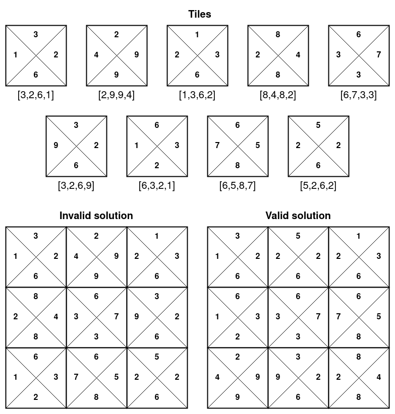

# Four-Sided Dominoes Search

This project was completed as part of my Introduction to Artificial Intelligence course for my MAsters Program.

The goal of the project was to solve a four-sided domino puzzle using informed and uninformed search techniques. Each state represents an arrangement of domino tiles, and neighboring tiles must have matching values along their touching sides.

## Problem Overview

The puzzle consists of an `N x N` grid of four-sided domino tiles.

A solution is valid when all adjacent sides between neighboring tiles match.

The search process explores different tile arrangements by swapping tiles until a valid configuration is found.

## Approach

The project models the puzzle as a search problem consisting of:

- **State:** the current arrangement of domino tiles
- **Actions:** swapping tiles to generate new arrangements
- **Goal Test:** checking whether all touching sides match
- **Successor Function:** generating new puzzle states from possible swaps

One of the search strategies implemented was **Breadth-First Search (BFS)**.

The BFS implementation uses:

- a FIFO queue
- a visited-state set to avoid repeatedly exploring the same arrangements
- path tracking to record the sequence of swaps leading to a solution

The GBFS implementatio nuses:
- The GBFS implementation uses a heuristic function to estimate how close each state is to a valid solution.
- t uses a priority queue to explore the most promising states first and a visited-state set to avoid repeatedly exploring the same arrangements.

## What I Learned

This project helped reinforce several concepts from artificial intelligence and search algorithms, including:

- representing real problems as state-space search problems
- generating successor states
- detecting goal states
- preventing repeated-state exploration
- understanding how quickly search spaces grow as problem size increases
- connecting theoretical search algorithms with practical implementations

## Technologies

- Python
- Jupyter Notebook
- Breadth-First Search
- State-space search

## Project Files

- `four_sided_dominoes_search.ipynb` — completed implementation and experimentation
- `images/valid_vs_invalid_solution.png` — example of valid and invalid puzzle configurations

## Course

**CAP 5625 — Introduction to Artificial Intelligence**